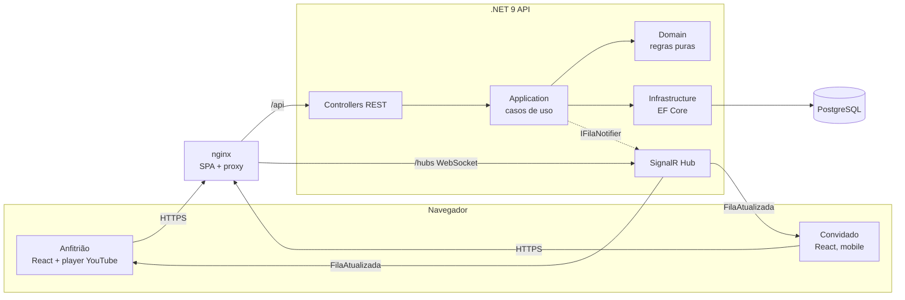

# 🎤 Karaokê — fila em tempo real

O anfitrião toca os vídeos na TV. A galera escolhe as músicas **pelo celular**, sem cadastro, e a fila se atualiza ao vivo para todo mundo — com regra de revezamento para ninguém dominar o microfone.

> Projeto de portfólio: **React + TypeScript** no front, **.NET 9 (Clean Architecture)** no back, **SignalR** para o tempo real.

## Como funciona

1. O **anfitrião** cria uma conta, cria um evento e abre o palco numa TV/projetor. A tela mostra um **código de 6 letras e um QR code**.
2. Cada **convidado** escaneia o QR (ou digita o código), informa só o nome e já pode buscar músicas ou colar um link do YouTube.
3. A fila aparece **em tempo real** para todos. O anfitrião controla o player (iniciar, finalizar, pular); ao terminar o vídeo, a próxima música entra sozinha.
4. A ordem pode ser **chegada** (FIFO) ou **revezamento** (todo mundo canta uma vez antes de alguém repetir). Trocar o modo reordena a fila ao vivo.

## Arquitetura



**Fluxo de uma mudança:** a ação vai por REST (passa por autenticação e regras) → o caso de uso grava e monta a fila completa → o `IFilaNotifier` (implementado com SignalR) empurra a fila para o grupo do evento → o React escreve no cache do TanStack Query e a tela se atualiza.

### Back-end (`src/`)

| Projeto | Responsabilidade |
|---|---|
| `Karaoke.Domain` | Entidades e **regras puras**, sem dependência de framework: `OrdenadorFila` (FIFO/revezamento), `YouTubeUrl` (valida e extrai o id do vídeo), `Evento` (código sem caracteres ambíguos) |
| `Karaoke.Application` | Casos de uso (`FilaService`, `EventoService`, `PlaylistService`…), DTOs, `Result<T>` e as interfaces `IKaraokeDbContext` / `IFilaNotifier` |
| `Karaoke.Infrastructure` | EF Core (Sqlite, Postgres ou SQL Server por configuração), Identity e migrations |
| `Karaoke.Api` | Controllers finos, hub SignalR, Swagger, cookie auth, rate limiting |

### Front-end (`src/karaoke-web`)

- **Vite + React 19 + TypeScript** (estrito, `noUncheckedIndexedAccess`).
- **TanStack Query** para estado do servidor; o **SignalR escreve direto no cache**, então a tela nunca fica velha.
- **Zustand** só para a sessão do convidado (persistida no navegador: recarregar não pede o nome de novo).
- **Tipos gerados do Swagger** (`npm run gen:api`) — front e back não divergem em silêncio.
- **Code splitting por rota:** o convidado, no celular, não baixa o player nem o gerador de QR.
- **Tailwind v4**, mobile-first, foco visível, `aria-live` para anunciar troca de música, link "pular para o conteúdo", `prefers-reduced-motion` respeitado.
- Player usando a **YouTube IFrame API** diretamente (sem wrapper), com tratamento de vídeo bloqueado/removido: pula sozinho.

## Decisões que valem a conversa

| Decisão | Por quê |
|---|---|
| Ações por **REST**, tempo real só para **empurrar** estado | Toda regra de autorização fica num lugar só (controllers/casos de uso); o hub é só um canal de broadcast |
| O hub envia a **fila inteira**, não eventos incrementais | A fila é pequena; elimina bugs de ordem/duplicação e deixa reconexão trivial (entrou no grupo, recebe a foto atual) |
| Convidado **sem conta**, com **token aleatório** por evento | Zero atrito na festa. O token vale só naquele evento e só dá poder sobre as músicas do próprio convidado |
| **Cookie** de autenticação em vez de JWT | Front e API ficam na mesma origem (proxy do Vite / nginx), então cookie `HttpOnly` é mais seguro que token em `localStorage` |
| Regra de ordem em **função pura** no Domain | É a parte mais cheia de casos de borda; testar sem banco é rápido e determinístico |
| Limite de **3 músicas aguardando** por pessoa | Evita que uma pessoa monopolize a fila, e a regra mora no back-end (o front só a espelha) |
| Só links do **YouTube** (lista de hosts + id de 11 caracteres) | Impede que o app vire proxy para URLs arbitrárias |

## Rodando localmente

Pré-requisitos: **.NET SDK 9+** e **Node 24+**.

```bash
# 1) API (http://localhost:5009, Swagger em /swagger). Usa Sqlite e migra sozinha.
dotnet run --project src/Karaoke.Api --launch-profile http

# 2) Front (http://localhost:5173) — o Vite faz proxy de /api e /hubs para a API
cd src/karaoke-web
npm install
npm run dev
```

Para testar com o celular na mesma rede, abra `http://<ip-do-pc>:5173` (o Vite já escuta em `0.0.0.0`).

Para criar um admin local, use user-secrets (nunca senha no código):

```bash
dotnet user-secrets --project src/Karaoke.Api set "Seed:AdminEmail" "voce@exemplo.com"
dotnet user-secrets --project src/Karaoke.Api set "Seed:AdminPassword" "UmaSenhaForte1"
```

## Testes

```bash
dotnet test                       # xUnit: domínio + casos de uso (Sqlite em memória com as migrations reais)
cd src/karaoke-web && npm test    # Vitest + Testing Library
npm run lint && npm run build     # ESLint + typecheck + build de produção
```

- **Back:** regras de fila (FIFO, revezamento, quem já cantou), limites, autorização (host × convidado × intruso), validação de links, ciclo do evento.
- **Front:** lógica de fila, cliente HTTP (erros, token, 204), componentes e o fluxo do convidado (entrar → escolher → erro do servidor).

A cada push o GitHub Actions roda tudo isso e ainda constrói as imagens Docker (`.github/workflows/ci.yml`).

## Deploy na VPS

```bash
git clone <repo> && cd Karaoke
cp .env.example .env        # defina POSTGRES_PASSWORD (e, se quiser, o admin)
docker compose up -d --build
```

Sobe **Postgres + API + nginx** (SPA e proxy, com suporte a WebSocket). A API não é publicada diretamente; só o nginx escuta em `WEB_PORT` (padrão `8080`). Coloque um proxy com TLS na frente (Caddy/Traefik/nginx do host) apontando para essa porta — o nginx do compose já respeita `X-Forwarded-Proto`.

> Atenção ao proxy do host: ele precisa repassar WebSocket (`Upgrade`/`Connection`) em `/hubs/`.

## Segurança (resumo)

- Senhas com ASP.NET Identity (hash + lockout após 5 falhas); cookie `HttpOnly`, `SameSite=Lax`.
- Rate limiting nas rotas públicas (login, cadastro, entrar em evento).
- Autorização **no servidor** para tudo: host só controla os próprios eventos; convidado só remove as próprias músicas e só enquanto aguardam.
- Nenhuma credencial no repositório: admin inicial vem de configuração/variável de ambiente.
- Container da API roda sem privilégios.

## Roadmap

- [ ] Telas para gerenciar playlists/biblioteca (a API já existe em `/api/playlists`)
- [ ] Teste E2E com Playwright (host + convidado em dois contextos)
- [ ] Votação da plateia e modo "pular fila" para aniversariante
- [ ] Pontuação por afinação (Web Audio API)
- [ ] PWA instalável para o convidado
